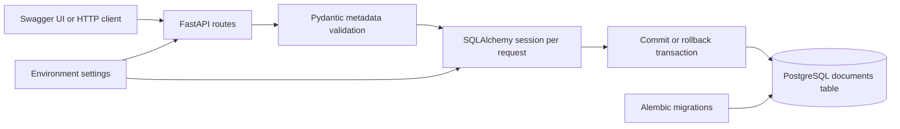

# Module 2 — PostgreSQL metadata persistence

## What you are learning

Module 1 checked whether supplied metadata was valid. Module 2 saves validated
metadata so it remains available after the API process stops. A metadata record
does **not** mean the corresponding file has been uploaded, read, or verified.

### PostgreSQL, tables, and models

PostgreSQL is a relational database server. A database contains tables; a table
contains rows with typed columns. A primary key identifies one row. Constraints
reject invalid stored values even when someone bypasses the API.

SQLAlchemy's ORM maps a Python class to a table and an instance to a row. Here,
`Document` is the database model. Pydantic's `DocumentMetadata`, `DocumentUpdate`,
and `DocumentRead` are API contracts: they validate incoming data and define the
JSON returned to callers. Keeping those roles separate prevents clients from
choosing server-owned IDs or timestamps.

### Engine, session, and transaction

The **engine** manages a pool of database connections. We create one per app
instance. A **session** tracks ORM objects and pending changes during one request;
it is never shared between requests. A **transaction** makes a group of changes
atomic: all succeed together (`commit`) or none persist (`rollback`).

```python
with session.begin():
    document = Document(**metadata.model_dump())
    session.add(document)
    session.flush()  # Send INSERT, populate defaults; this is not a commit.
    session.refresh(document)  # Read database-generated values.
# Successful exit commits. An exception inside the block rolls back.
```

The actual routes build their response while the session is open and return only
after the transaction exits successfully. PATCH and DELETE lock the selected row
until completion so concurrent writes cannot interleave their read/write steps.
SQLAlchemy database failures return a generic 503; neither SQL parameters nor
database passwords are returned to the caller. This does not automatically retry
writes: a lost connection at commit can leave the outcome uncertain, so clients
must not blindly retry creates. Idempotency keys are future work.

We use synchronous SQLAlchemy with psycopg 3 for a smaller learning surface.
FastAPI runs these normal `def` routes and dependencies in its worker thread
pool. Do not call this blocking database layer directly from an `async def` route.

### Migrations and Alembic

A migration is a versioned description of a schema change. Alembic's
`alembic_version` table records the applied revision. Editing an ORM model alone
does **not** update an existing database.

`0001_create_documents.py` creates the documents table, constraints, and index.
Application startup deliberately does not create tables. Apply migrations
explicitly before using storage endpoints:

```powershell
poetry run alembic upgrade head
poetry run alembic current
poetry run alembic check
```

For a future schema change, edit the model, run
`poetry run alembic revision --autogenerate -m "describe the change"`, inspect the
generated migration, and test it before running `upgrade head`. Autogeneration
is a draft, not proof of a safe migration. A downgrade that drops a table destroys
its rows; do not run it on data you want to keep. Our downgrade test uses a fresh
temporary schema inside a rolled-back transaction in the test database.

## Architecture



The service stays deliberately small: routes coordinate validation and database
operations directly. A repository/service abstraction is unnecessary until
business logic grows. There is no database, queue, or cloud subscription to pay
for beyond the local PostgreSQL installation.

| Column | Storage and ownership |
| --- | --- |
| `id` | UUID primary key generated by the application; immutable |
| `filename` | Required string, up to 255 characters; same rules as Module 1 |
| `content_type` | Required normalized MIME type matching the extension |
| `size_bytes` | Positive 64-bit integer; API enforces the configured size limit |
| `status` | `registered` (default) or `archived`; database check constraint |
| `created_at` | PostgreSQL timestamp with time zone; generated on insert |
| `updated_at` | Timestamp with time zone; generated on insert and ORM updates |

`registered` means metadata was saved. `archived` means the record is marked
inactive, but it is still retrievable and may be changed back to `registered`.
Neither status claims a file exists. DELETE permanently removes the metadata row.
Duplicate filenames are allowed; different UUIDs distinguish different records.

Database connections use UTC. PostgreSQL timestamps preserve an instant; the API
returns an ISO 8601 timestamp with a timezone. SQLAlchemy updates `updated_at`
when a row actually changes; a no-op PATCH need not advance it. Direct SQL updates
must set the timestamp themselves because this module does not install a trigger.
The configurable 10 MB limit and extension/MIME relationship belong to API
validation, while the database independently enforces non-null values, lengths,
positive size, nonblank names/types, and valid status.

## File responsibilities

All paths below are relative to the repository root.

| File | Purpose |
| --- | --- |
| `backend/pyproject.toml`, `backend/poetry.lock` | Dependency ranges and locked versions; PostgreSQL test marker |
| `backend/.env.example` | Configuration names and placeholder URL format, never real credentials |
| `.gitignore` | Excludes local configuration, credentials, environments, caches, and `.local` database data |
| `backend/src/agentsphere/config.py` | Loads settings; validates PostgreSQL URLs; redacts them in representations |
| `backend/src/agentsphere/main.py` | Creates the app, engine/session factory, and routes; disposes the engine on shutdown |
| `backend/src/agentsphere/models.py` | ORM base, Document table, status enum, constraints, timestamps, and index |
| `backend/src/agentsphere/database.py` | Connection pool, session dependency, and sanitized database error handling |
| `backend/src/agentsphere/schemas/documents.py` | Existing validation plus create/read/PATCH/page API contracts |
| `backend/src/agentsphere/api/document_records.py` | Metadata CRUD, transactions, pagination, and status filtering |
| `backend/src/agentsphere/api/documents.py` | Unchanged Module 1 validation-only endpoint |
| `backend/src/agentsphere/api/health.py` | Unchanged process-liveness endpoint |
| `backend/alembic.ini` | Alembic location; no connection password |
| `backend/migrations/env.py` | Connects Alembic to settings and ORM metadata |
| `backend/migrations/script.py.mako` | Template for future migration files |
| `backend/migrations/versions/0001_create_documents.py` | Initial explicit schema migration |
| `backend/scripts/local_postgres.py` | Creates/starts/stops an isolated local PostgreSQL cluster using installed binaries |
| `backend/tests/conftest.py` | Keeps existing unit tests independent of local database configuration |
| `backend/tests/test_database_config.py` | URL validation/redaction, missing database, and connection failure checks |
| `backend/tests/integration/conftest.py` | Dedicated PostgreSQL database, migrations, and transaction-isolated fixtures |
| `backend/tests/integration/test_document_crud.py` | CRUD, pagination, invalid input, limits, timestamps, and persistence checks |
| `backend/tests/integration/test_database_integrity.py` | Migration consistency, upgrade/downgrade, database constraints, and rollback |
| `backend/README.md`, `docs/MODULE2.md` | Quick start and this learning guide |

## Local setup with the existing Poetry environment

Open the **cloned** repository in VS Code, then a PowerShell terminal:

```powershell
Set-Location 'C:\Users\yvenk\Desktop\agentsphere-ai\AgentSphere-AI\backend'
git branch --show-current  # Must be develop for this work.
```

If Poetry is on PATH, use `poetry install`. On this workstation its existing
executable is outside the clone; this runs that tool without changing the backup
project's source files:

```powershell
$poetryExe = 'C:\Users\yvenk\Desktop\agentsphere-ai\.tools\poetry\Scripts\poetry.exe'
Test-Path $poetryExe
Test-Path '.\.venv\Scripts\python.exe'
$env:PYTHONDONTWRITEBYTECODE = '1'
& $poetryExe install
```

The remaining commands use the existing environment directly, so Poetry need not
be on PATH. On a fresh clone, install Python/Poetry first and use `poetry install`
to create the environment; `poetry env info --executable` shows its interpreter.

### Create PostgreSQL locally once

This workstation already has PostgreSQL 18 at
`C:\Program Files\PostgreSQL\18\bin`. The helper uses those binaries to initialize
a **separate** cluster on loopback port **55432**. It never changes or stops the
existing Windows PostgreSQL service on 5432.

```powershell
.\.venv\Scripts\python.exe scripts/local_postgres.py init
.\.venv\Scripts\python.exe -m alembic upgrade head
```

The helper creates two distinct database owners without superuser, role-creation,
or database-creation privileges: `agentsphere` owns the development database,
and `agentsphere_test` owns the test database. Each gets a generated password.
The local administrative credential is kept in ignored
`backend/.local/postgres-config.json`; connection URLs go into ignored
`backend/.env`. Those files contain secrets: keep them local. The database data
directory and log also live in `.local`. SCRAM password authentication is enabled.
Restrict your OS account and folder access; this is a development setup.

`init` refuses existing data/configuration and checks that the port is free. It
does not overwrite or delete anything. If setup fails partway through, inspect
the error and existing local files before taking recovery steps; do not repeatedly
run init or delete a database to make the error disappear.

For another PostgreSQL installation, pass
`--bin-dir 'C:\Program Files\PostgreSQL\17\bin'` to the helper. The same option
must accompany later commands if binaries are not on PATH. On Unix, install
PostgreSQL, make its binaries discoverable, and run the helper as a regular user.

On subsequent days:

```powershell
.\.venv\Scripts\python.exe scripts/local_postgres.py start
.\.venv\Scripts\python.exe scripts/local_postgres.py status
.\.venv\Scripts\python.exe -m alembic upgrade head
```

After stopping the API, stop only this isolated database with:

```powershell
.\.venv\Scripts\python.exe scripts/local_postgres.py stop
```

Stopping preserves data. Starting does not reinitialize it. Do not commit `.local`
or `.env`. If you already use your own databases, skip the helper: configure
`DATABASE_URL` and `TEST_DATABASE_URL` using `.env.example`, with different
databases and a test database name ending in `_test`. URL-encode special characters
in passwords. Environment variables override `.env` values. Never paste real
connection URLs into logs, screenshots, Git, or chat.

### Start the application

```powershell
.\.venv\Scripts\python.exe -m uvicorn agentsphere.main:create_app --factory --reload --host 127.0.0.1 --port 8000
```

Open [Swagger UI](http://127.0.0.1:8000/docs). Ctrl+C stops this server. If port 8000
is already occupied, use the existing AgentSphere server only if its Swagger
version is `0.2.0`; otherwise stop your own old server or choose another port.
Never stop an unrelated process just to free a port.

## CRUD endpoints and Swagger walkthrough

CRUD means Create, Read, Update, Delete.

| Method and path | Success | Behavior |
| --- | --- | --- |
| `GET /health/live` | 200 | Process is alive; does not test database readiness |
| `POST /api/v1/documents/validate` | 200 | Validate only; never inserts a row |
| `POST /api/v1/documents` | 201 | Save metadata; response includes UUID/timestamps/status and Location header |
| `GET /api/v1/documents` | 200 | Paginated list; optional status filter |
| `GET /api/v1/documents/{document_id}` | 200 | Retrieve one saved record |
| `PATCH /api/v1/documents/{document_id}` | 200 | Change supplied metadata/status fields; ID/timestamps are read-only |
| `DELETE /api/v1/documents/{document_id}` | 204 | Delete one metadata row; empty response body |

1. Expand **POST /api/v1/documents**, click **Try it out**, and execute:

   ```json
   {"filename": "research.pdf", "content_type": "application/pdf", "size_bytes": 2048}
   ```

2. Expect **201**. Copy the returned `id`. This record should have status
   `registered`, two timezone-aware timestamps, and the submitted metadata.
3. GET the list with `limit=20`, `offset=0`. The response contains `items`, `limit`,
   `offset`, and `has_more`. Records sort newest first with UUID as a tie breaker.
   A maximum of 100 records is returned per page. Offset pagination is simple but
   concurrent inserts/deletes can move records between pages; snapshot pagination
   is outside this module.
4. GET `/{document_id}` using the copied UUID. Expect the same record.
5. PATCH that UUID with `{"status":"archived"}`. Expect **200**. GET the list with
   `status=archived` to find it. To change the format, change filename and MIME type
   together: `{"filename":"notes.txt","content_type":"text/plain"}`.
6. Send an invalid PATCH such as `{"filename":"notes.exe"}`. Expect **422**, then
   GET again to confirm the saved row did not change. Empty PATCH, explicit null,
   unknown fields, unsupported formats, and mismatched MIME types are invalid.
7. Send `size_bytes: 10000001` in a valid create or PATCH body. Expect **413**. The
   default maximum is exactly **10,000,000 bytes** (decimal MB), inclusive.
8. Stop/restart the API without stopping PostgreSQL and GET the UUID again. The
   row persists because its transaction was committed to PostgreSQL.
9. DELETE the UUID. Expect **204**, then **404** on a subsequent GET or DELETE.

Malformed UUIDs and invalid query/body values produce **422**. A valid but missing
UUID produces **404**. Unconfigured/unavailable databases produce **503** for
storage operations; `/health/live` and `/documents/validate` still work. Invalid
request metadata may be rejected before a database is contacted.

## Automated verification

Verified on 2026-10-16 with PostgreSQL 18.6 and Python 3.12.2: **102 tests passed,
0 failed, 0 skipped** (the original 61 plus 41 new tests). The live API also passed
**17 HTTP checks**, and Ruff lint/format checks and `alembic check` passed. Alembic
reported revision `0001 (head)`. The test run emitted one upstream
Starlette/HTTPX deprecation warning; it did not affect test outcomes.

```powershell
.\.venv\Scripts\python.exe -m pytest -q
.\.venv\Scripts\python.exe -m pytest -q -m 'not postgres'
.\.venv\Scripts\python.exe -m pytest -q -m postgres
.\.venv\Scripts\python.exe -m alembic check
```

The PostgreSQL tests use real PostgreSQL, not SQLite. Without `TEST_DATABASE_URL`,
they explicitly skip; that is not a complete integration-test pass. A configured
but unreachable test database fails rather than silently skipping. The fixture
requires a database name ending in `_test` and refuses the same configured
host/port/database as development. Only point it at a dedicated test database.
Do not run this suite concurrently against a shared test database.

Most HTTP tests use savepoints inside an outer transaction, so even an endpoint's
commit is rolled back after the test. The persistence test deliberately commits
and cleans up only its own UUID in `finally`. A simulated failure after INSERT
verifies that rollback leaves no row and database error details stay hidden.
Migration tests verify model/schema agreement and an upgrade/downgrade roundtrip
in an isolated test schema. Constraint tests bypass Pydantic and exercise the
database directly. Existing Module 1 tests remain part of the full suite.

## Exercises before the next module

1. Trace a POST from `DocumentMetadata` through `session.add`, `flush`, and commit.
   Explain why returning an ID before a successful commit would be misleading.
2. Explain why changing `.pdf` to `.txt` without changing `content_type` fails.
3. Use Swagger to create two records with the same filename and compare their IDs.
4. Restart the API and explain why the records survive while Python objects do not.
5. Read the migration and find the constraints that protect direct SQL inserts.
   Explain why an API model and a database migration are separate files.

Module 2 does not include authentication, authorization, file uploads, document
contents, AI processing, or production deployment. Keep the server bound to
localhost. Production would also need managed secrets, encrypted connections,
backups, narrower migration/runtime roles, and access controls.

Further reading: [SQLAlchemy sessions](https://docs.sqlalchemy.org/en/20/orm/session_basics.html),
[Alembic tutorial](https://alembic.sqlalchemy.org/en/latest/tutorial.html),
[PostgreSQL initdb](https://www.postgresql.org/docs/18/app-initdb.html), and
[FastAPI database concepts](https://fastapi.tiangolo.com/tutorial/sql-databases/)
(that tutorial uses SQLModel; this project deliberately uses SQLAlchemy directly).
