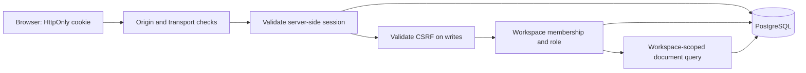

# Module 3 — Authentication and workspace authorization

This module adds accounts, Argon2id passwords, PostgreSQL-backed browser sessions,
CSRF protection, shared authentication throttling, and workspace permissions.
It still stores only document metadata. It does not upload files or run AI agents.

## Concepts and architecture

**Authentication** establishes who made a request. **Authorization** checks what
that user may do to a particular resource. A valid login alone never grants access
to another workspace.



The cookie is a random bearer credential: possession can authenticate a caller.
JavaScript cannot read an HttpOnly cookie, but the browser sends it with requests.
Therefore a separate CSRF token is required on state-changing requests. SameSite
cookies and strict Origin checks provide additional defenses.

Argon2id is deliberately expensive to make password guessing harder. We use
`argon2-cffi`, 64 MiB memory, three iterations, one lane, and a random salt per
hash. Passwords allow 15–128 characters, including spaces and Unicode, with no
silent trimming. Successful login upgrades hashes when parameters change.
Unknown accounts still perform dummy hash verification. This reduces timing
differences but is not a claim of identical response times.
Each worker permits at most two simultaneous password hash/verify operations;
excess demand returns 503 with Retry-After rather than allocating more Argon2 memory.

Session identifiers contain 32 random bytes (256 bits), encoded as URL-safe text.
Only their SHA-256 digest is stored in PostgreSQL. Fast hashing is appropriate for
these high-entropy random tokens, but would be inappropriate for human passwords.
The server-side CSRF secret is separate and is not sufficient to authenticate.

## Database design and migration

| Table | Responsibility |
| --- | --- |
| `users` | UUID, normalized unique email, Argon2id hash, display name, active flag, timestamps |
| `sessions` | Token digest, optional user ID, CSRF secret, creation/activity/expiry/revocation times |
| `workspaces` | UUID, name, authoritative owner user ID, timestamps |
| `workspace_memberships` | Unique workspace/user pair and `editor` or `viewer` role |
| `auth_rate_limits` | HMAC identity digest, scope, window, atomic counter, expiry |
| `documents` | Existing metadata plus required workspace foreign key and workspace listing index |

Owners do not have duplicate membership rows. There is no ownership transfer,
user deletion, or workspace deletion API in this module. Foreign keys prevent
accidental removal of referenced users/workspaces.

Revision `0001` remains unchanged. Revision `0002` locks and checks `documents`
before creating security tables and adding required workspace ownership. If any
legacy documents exist, it raises an error and the transaction rolls back. Stop
and arrange an explicit ownership mapping; do not delete data to bypass the guard.
Downgrading also refuses populated authentication/document tables. Production
rollbacks require a reviewed data-preservation plan, not an automatic downgrade.

At the start of this implementation, both local development and test databases
had zero document records. The development database was upgraded to `0002`.

## Sessions, transactions, and permissions

Default expiry is 30 minutes of inactivity or 12 hours absolute, whichever comes
first. Anonymous CSRF sessions last 10 minutes. Login revokes the anonymous
session, issues a new cookie, and rotates CSRF. Logout revokes the server record
and clears the cookie; logout-all revokes all current sessions for that user.
Neither logout nor membership removal relies on the browser cooperating.

One SQLAlchemy transaction spans authentication, authorization, and route writes.
Its function-scoped dependency commits before sending a success response. Database
errors roll back and produce sanitized 503 responses. Failed-login rate counters
use a separate committed transaction, so a 401 cannot undo throttling.

Requests lock the current user, then its session. Workspace operations then lock
the workspace; membership management uses the same order. This serializes writes
with removal of permissions. User locks use PostgreSQL `FOR NO KEY UPDATE` to
remain compatible with foreign-key checks. This deliberately simple locking model
limits per-user/workspace throughput; revisit it when scaling beyond this module.

| Capability | Owner | Editor | Viewer |
| --- | --- | --- | --- |
| Read/list documents | Yes | Yes | Yes |
| Create/update/archive/delete metadata | Yes | Yes | No |
| List/add/change/remove members | Yes | No | No |

Memberships reference existing user UUIDs, obtained from that user's registration
or `/auth/me` response. There is no global user directory or email-based invitation
flow. Nonmembers receive 404; members lacking a required role receive 403.
Documents are always queried by both workspace ID and document ID.

## Configuration and local startup

Run commands in the cloned repository's `backend` directory on `develop`:

```powershell
cd C:\Users\yvenk\Desktop\agentsphere-ai\AgentSphere-AI\backend
git branch --show-current
poetry install --with lint
```

If Poetry is not on PATH, use the existing executable:

```powershell
$poetryExe = 'C:\Users\yvenk\Desktop\agentsphere-ai\.tools\poetry\Scripts\poetry.exe'
$env:PYTHONDONTWRITEBYTECODE = '1'
& $poetryExe install --with lint
```

The existing `.venv` can execute the remaining commands directly. Keep the
isolated PostgreSQL instance running, then apply migrations before starting API:

```powershell
.\.venv\Scripts\python.exe scripts/local_postgres.py start
.\.venv\Scripts\python.exe -m alembic upgrade head
```

For a new local database, follow Module 2's `local_postgres.py init` instructions
first. That helper uses PostgreSQL binaries already installed on the computer.

Secure defaults require HTTPS and set `__Host-agentsphere_session` with `Secure`,
`HttpOnly`, `SameSite=Lax`, `Path=/`, and no Domain. `.env.example` documents the
settings; provide a random `AUTH_RATE_LIMIT_KEY` of at least 32 characters. The
same secret must be used across app workers so rate-limit identities agree.

For **explicit loopback-only HTTP development**, this helper appends settings and
a generated secret to an existing ignored `.env`, refusing to overwrite auth
settings already present:

```powershell
.\.venv\Scripts\python.exe scripts/configure_local_auth.py
```

This workstation has already been configured by that helper. It uses:

```dotenv
ENVIRONMENT=development
APP_ORIGIN=http://127.0.0.1:8000
ALLOW_INSECURE_LOCAL_HTTP=true
```

The generated key is intentionally omitted above. Local HTTP uses the separately
named `agentsphere_dev_session` cookie with HttpOnly and SameSite, but **without
Secure**. The app rejects non-loopback clients in this mode. Production refuses
this setting. Do not deploy the development configuration.

```powershell
.\.venv\Scripts\python.exe -m uvicorn agentsphere.main:create_app --factory --reload --host 127.0.0.1 --port 8000 --no-proxy-headers
```

Use the exact [configured origin](http://127.0.0.1:8000/docs), not `localhost` as an
interchangeable hostname. Origin and Host checks intentionally distinguish them.
For local HTTPS, provide a trusted local certificate/key, set
`APP_ORIGIN=https://localhost:8443`, disable insecure HTTP, and use Uvicorn's
`--ssl-certfile`/`--ssl-keyfile` options on port 8443. Keep private keys ignored.

The application uses the connection peer IP for rate limits. Uvicorn can rewrite
that IP from forwarded headers, so the local command explicitly disables them.
Behind a real TLS proxy, configure only known proxy addresses; never trust arbitrary
forwarded headers. CORS is not enabled in this module: use a same-origin frontend.

## Swagger walkthrough

Swagger now exposes an **Authorize → CSRF** header control. This does not log you
in; the HttpOnly cookie establishes authentication. Never paste the session cookie
into the CSRF control.

1. Execute `GET /api/v1/auth/csrf`. The browser stores an anonymous cookie.
2. Copy `csrf_token`, open **Authorize**, paste it into **CSRF**, and authorize.
3. Register with `POST /api/v1/auth/register`:

   ```json
   {"email":"learner@example.com","password":"A long example passphrase!","display_name":"Learner"}
   ```

   Use your own password for your local account. Expect 201 with `user` and a
   personal `workspace`; copy the workspace ID. Registration does not log you in.
4. Execute `POST /api/v1/auth/login` using the same email/password. Expect 200.
   The server sets a new cookie and returns a **new** CSRF token. Replace the
   token in Swagger's Authorize dialog; the old token is intentionally invalid.
5. GET `/api/v1/auth/me` and `/api/v1/workspaces` to inspect your identity/access.
6. Create metadata at `POST /api/v1/workspaces/{workspace_id}/documents`:

   ```json
   {"filename":"research.pdf","content_type":"application/pdf","size_bytes":2048}
   ```

7. List, retrieve, PATCH, and DELETE through that same workspace prefix. A viewer
   can read but cannot write. A different workspace ID cannot expose this record.
8. POST `/api/v1/auth/logout` with CSRF. Expect 204 and then 401 from `/auth/me`.
   Fetch a fresh anonymous CSRF token before logging in again.

Login, registration, CSRF, session expiry, and permission errors are deliberately
visible in Swagger. Refresh CSRF and log in again when an expired session returns
401/403. Keep CSRF in memory, not URLs or localStorage. Auth responses use no-store.

## API contract

All paths below begin with `/api/v1`.

| Method/path | Request / success |
| --- | --- |
| `GET /auth/csrf` | 200 `{csrf_token}` plus anonymous cookie if needed |
| `POST /auth/register` | `{email,password,display_name}` → 201 `{user,workspace}` |
| `POST /auth/login` | `{email,password}` → 200 `{user,csrf_token,expires_at}` plus new cookie |
| `GET /auth/me` | 200 public user fields only |
| `POST /auth/logout` | 204; revoke current session |
| `POST /auth/logout-all` | 204; revoke all current user's sessions |
| `POST /workspaces` | `{name}` → 201 workspace; caller becomes owner |
| `GET /workspaces` | Paginated `{items,limit,offset,has_more}`; accessible workspaces only |
| `GET /workspaces/{id}` | Workspace with effective role |
| `GET /workspaces/{id}/members` | Owner only; owner UUID and paginated memberships |
| `POST /workspaces/{id}/members` | Owner supplies `{user_id,role}` → 201 |
| `PATCH /workspaces/{id}/members/{user_id}` | Owner supplies `{role}` → 200 |
| `DELETE /workspaces/{id}/members/{user_id}` | Owner removes membership → 204 |

Document collection: `/workspaces/{workspace_id}/documents` (POST/GET).
Individual document: `/workspaces/{workspace_id}/documents/{document_id}`
(GET/PATCH/DELETE). Existing metadata fields, limits, pagination, and status values
are preserved; responses also include immutable `workspace_id`.

All writes to these APIs require the cookie plus `X-CSRF-Token`. Browser origins
must match `APP_ORIGIN`; Origin `null`, cross-site Fetch Metadata, and untrusted
Referer values are rejected. Non-browser clients may omit Origin/Referer but must
still supply both session cookie and CSRF token.

Status codes: 401 invalid authentication; 403 CSRF/origin/role denial; 404 missing
or inaccessible resource; 409 duplicate account/membership or prohibited account
switch; 413 oversized body/file declaration; 422 invalid input; 429 throttled with
Retry-After; 503 unavailable database/auth configuration. Login errors do not
distinguish nonexistent, disabled, and wrong-password accounts. Duplicate
registration returns 409, which can reveal account existence; email verification
and an enumeration-resistant signup flow remain future work.

**Compatibility:** `/health/live` and `/api/v1/documents/validate` stay public and
unchanged. Old unscoped document CRUD endpoints now return 404 and cannot bypass
workspace authorization. Module 2 consumers/tests must migrate to the new paths
and use cookie/CSRF authentication.

## Rate limits and maintenance

| Scope | Default fixed-window limit |
| --- | --- |
| Login per normalized account | 10 / 15 minutes |
| Login per connection IP | 30 / 5 minutes |
| Registration per IP | 5 / hour |
| CSRF bootstrap per IP | 60 / minute |

Counters are PostgreSQL atomic UPSERTs shared across workers; rejected attempts
also count. Keys contain HMAC digests, not plaintext emails/IPs. Fixed windows can
allow a burst around their boundary; they are not a sliding-window guarantee.
Account throttling can temporarily affect a victim targeted by an attacker. Tune
limits for shared networks and add upstream abuse controls before public exposure.

To remove only expired/revoked sessions and expired rate buckets:

```powershell
.\.venv\Scripts\python.exe scripts/cleanup_auth.py
```

The command does not remove accounts, workspaces, or documents. It is manual in
this module; a deployment should schedule maintenance. Authentication remains
correct before cleanup because every request checks expiry/revocation.

## Files and tests

`models.py` defines storage; `schemas/auth.py` defines public inputs/outputs.
`security.py` handles hashes, cookies, clocks, and session dependencies.
`rate_limits.py` owns atomic shared counters. `middleware.py` checks transport,
origin, auth body size (8 KiB), and no-store headers. `permissions.py` enforces roles.
`api/auth.py`, `api/workspaces.py`, and `api/document_records.py` implement routes.
`database.py` now owns the transaction boundary. `main.py` wires these together
and redacts authentication validation errors. Configuration lives in `config.py`
and `.env.example`; real settings stay ignored.

`0002_auth_workspaces.py` is the guarded migration. The two new scripts configure
local auth and clean expired state. Tests use random isolated schemas inside a
dedicated `_test` database, with real commits and independent connections. They
drop only their own generated schema afterward. Existing database records are
never truncated. Time-based tests use a controlled clock instead of long sleeps.

```powershell
.\.venv\Scripts\python.exe -m pytest -q
.\.venv\Scripts\python.exe -m ruff check src tests migrations scripts
.\.venv\Scripts\python.exe -m ruff format --check src tests migrations scripts
.\.venv\Scripts\python.exe -m alembic current
.\.venv\Scripts\python.exe -m alembic check
```

Security tests cover password hashing/rehashing, secure cookie attributes, login
rotation, expiry, revocation, invalid sessions, CSRF before and after login,
hostile origins, all role/CRUD combinations, workspace ID attacks, immediate
membership removal, credential redaction, concurrent registration, concurrent
rate counters, and migration refusal without data loss. Module 1 tests remain;
Module 2 tests exercise the same metadata behavior through authenticated routes.
The existing upstream Starlette/HTTPX deprecation warning is not suppressed.

Verified on 2026-10-17: the complete suite passed **169 tests, 0 failures**
with one upstream Starlette/HTTPX deprecation warning. Ruff checks passed and all
35 Python files passed the formatting check. Alembic reported `0002 (head)` and
no new upgrade operations. Twelve live HTTP checks passed, covering public
health/docs, session bootstrap, unauthenticated access, CSRF, hostile origins,
oversized authentication requests, and retirement of the old document CRUD path.
These HTTP checks did not create accounts or documents.

For browser verification, check that login works through Swagger, CSRF is required
on writes, and the session cookie is not readable through `document.cookie`.
HTTP test clients verify server headers but do not model every browser security
behavior. Secure-mode headers are tested separately from explicit local HTTP.

This is a security foundation, not a complete public identity service. Email
verification, password recovery/change, MFA, TLS deployment, frontend XSS defenses,
audit retention, and production abuse monitoring are not implemented here.

Learning exercise: explain why changing a cookie in the browser cannot restore a
revoked session, why a valid UUID cannot bypass workspace checks, and why password
hashing and session-token hashing use different algorithms.
