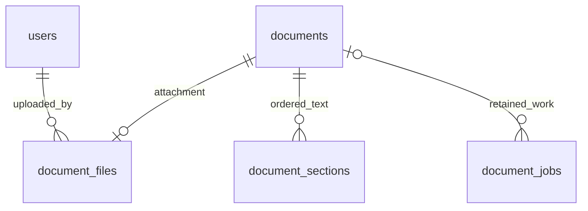

# Module 5 Stage 1 — PostgreSQL schema and private storage foundation

This stage adds database structures and an internal local-storage API. It does
not add upload/download endpoints, extraction, job execution, or React upload UI.
The existing metadata, authentication, CSRF, workspace and document APIs keep
their Module 4 contracts. No new dependencies or paid services are required.

## Concepts and relationships

A foreign key keeps references valid. A unique constraint prevents duplicate
attachments or positions. A check constraint rejects invalid values even when
code bypasses an API. An index helps locate work without scanning every row.
Alembic revision `0003`, following `0002`, creates only three new tables; it does
not alter the existing `documents` table or rewrite legacy rows.



`Document.status` remains `registered` or `archived`. Those values describe
lifecycle, not processing. An existing metadata-only record has no attachment
and remains valid. New ORM models do not automatically appear in API responses.

| Table | Main fields and invariants |
| --- | --- |
| `document_files` | UUID primary key; unique document FK; unique private storage key; original filename; SHA-256; uploader FK; upload timestamp; independent processing status; optional safe error/warning codes, parser version and processed timestamp |
| `document_sections` | UUID primary key; document FK; unique zero-based ordinal within a document; nonempty text; optional heading, one-based PDF page number and one-based inclusive line range |
| `document_jobs` | UUID primary key; optional document FK; retained storage key; kind/state; attempts/max attempts; availability time; lease token/expiry; created/updated/started/finished timestamps; optional safe error code |

`document_files.document_id` and `document_sections.document_id` use `ON DELETE
CASCADE`. `uploaded_by` uses `RESTRICT`. Job document references use `ON DELETE
SET NULL`; neither an attachment FK nor a workspace FK can cascade away the job.
Consequently, a cleanup job can retain its storage address after document and
attachment rows disappear.

The original filename is descriptive metadata and never an operating-system
path. Storage keys have this exact canonical format:

```text
objects/<32 lowercase UUID hex characters>/<32 lowercase UUID hex characters>/original
```

The first UUID identifies the workspace and the second the stored file. Both
come from server code. SQL checks and the storage abstraction reject arbitrary
paths. A digest must contain 64 lowercase hexadecimal characters. Error/warning
codes use bounded lowercase identifiers, not exception messages or raw paths.

Processing values are `queued`, `processing`, `ready`, `failed`. Job kinds are
`extract`, `delete_files`; job states are `queued`, `running`, `succeeded`,
`failed`, `cancelled`.

A lease is temporary ownership of a job. Running jobs must have a lease UUID,
expiry, start time and at least one attempt. Non-running jobs cannot retain
lease fields. Expiry must follow start time; terminal states require a finish
timestamp; queued/running states cannot have one. Attempts must be nonnegative,
not exceed the positive maximum, and default to zero out of three attempts.

Indexes support processing-state lookups, uploader references, section order,
available job selection, expired leases and document job lookup. Partial unique
indexes allow only one queued/running extraction per document and one active
cleanup per storage key. Completed job history can remain.

These fields support a future durable worker; they do not implement claiming,
lease renewal, fencing, retries, cancellation, or state-transition services yet.
Timestamps and related states must still be updated coherently by those services.

## Configuration and provisioning

`PRIVATE_STORAGE_ROOT` is an absolute local path. Its default is
`backend/.local/private_storage`, resolved relative to the installed project,
independently of the terminal's working directory. `.local/` is already ignored.
The configuration template contains only a commented example path.

```dotenv
# Example only: substitute your own local absolute path.
PRIVATE_STORAGE_ROOT=C:/Users/YOUR_USER/AppData/Local/AgentSphere/private_storage
```

Relative paths, parent traversal, network/UNC roots, filesystem roots, home
directories/ancestors, and public/source/Git locations are rejected. Windows
components with alternate-stream syntax or trailing dots/spaces are rejected.
The parent directory must already exist. Settings validation, constructing a
storage object, and normal application startup do not create storage directories.

Explicit initialization creates only the configured root and `objects`/`tmp`.
It validates the existing managed layout and rejects unknown entries, directory
links, Windows reparse points/junctions, nonregular leaves, and hardlinked leaves.
It never deletes existing content. The configured root is read-only on the
storage instance after construction.

On Windows, initialization applies protected ACLs to the root and existing
managed descendants: the current account, SYSTEM, and Administrators receive
access. Other inherited or explicit grants are removed from those managed
objects. This matters because a private parent ACL alone does not protect a
child with an independent permissive ACL. On POSIX, directories use `0700` and
files use `0600`. Explicit initialization therefore changes permissions inside
the configured storage tree; choose an application-owned directory only.

After reviewing the path, initialization can be run from `backend`:

```powershell
.\.venv\Scripts\python.exe -c "from agentsphere.config import Settings; from agentsphere.storage import PrivateStorage; storage = PrivateStorage(Settings().private_storage_root); storage.initialize()"
```

This command was not run against development storage during Stage 1 testing.
Tests provision only directories owned by pytest beneath its temporary root.
There is no `StaticFiles` mount, public storage URL, automatic startup initializer,
or new API schema exposing filesystem paths.

## Internal storage API

`new_storage_key(workspace_id, file_id=None)` accepts UUID objects and generates
a UUID4 file identifier when none is supplied. `PrivateStorage.initialize()` must
succeed before accessing objects.

| Operation | Behavior |
| --- | --- |
| `object_path(key)` | Validate the strict key and directory chain; produce an internal path only |
| `put(key, binary_source, max_bytes=...)` | Stream bounded bytes to a unique private temporary file; compute measured size and SHA-256; publish a new immutable object |
| `open(key)` | Return a binary handle the caller closes; reject links, hardlinks, nonregular files and changed file identity |
| `delete(key)` | Remove only the exact validated object; return false when already absent; retain directories |

`put` counts bytes as it reads. The limit is inclusive; empty objects and
nonbinary readers are rejected. File contents are flushed before publication.
A same-volume hard link publishes the completed temporary object atomically
without replacing an existing destination, then the temporary name is removed.
A collision raises `StorageConflict`. The filesystem must support hard links
(for example NTFS or a normal POSIX filesystem); unsupported operations fail
closed. This is not an upload endpoint or a document-format validator.

Filesystem errors expose sanitized `StorageError` messages; oversize writes raise
`StorageLimitExceeded`. Failed writes clean up only temporary names created by
that call. Cleanup failures are reported rather than silently claiming success.
No operation recursively deletes a directory or accepts a user filename as a key.

The abstraction does not authorize workspaces. Future services must check session,
CSRF and workspace permissions before calling it. UUID paths alone are not an
authorization boundary. The API account and trusted worker will be the only
writers; another process with that same account can race filesystem operations.
Link checks and ACLs do not form a sandbox against that trusted account or an
administrator.

## Migrations and preservation

Tests apply real migrations in a dedicated PostgreSQL test database, each using
a uniquely generated schema. The test URL guard rejects non-loopback hosts,
unsafe database names, query overrides and ambiguous development/test targets
before opening a connection. Tests never create or drop the development schema.

The clean-schema test upgrades through `0001`, `0002`, `0003`, verifies empty new
tables and runs Alembic's model-consistency check. The populated test creates a
Module 4 schema at `0002`, seeds users, workspace, membership, documents (registered
and archived), session and rate-limit records, snapshots every column, upgrades
to `0003`, and checks exact preservation plus unchanged document columns.

Downgrade to `0002` locks the new tables and refuses if any contains data. This
preserves storage addresses and text rather than silently discarding them. An
empty-storage downgrade preserves populated Module 4 tables and is tested in
isolation. No development migration or downgrade was performed during this stage;
the development database remains at its existing revision. The migration file's
new head is `0003`.

For a later deployment, select and back up the intended database before applying
the migration. From `backend`, the normal commands are:

```powershell
.\.venv\Scripts\python.exe -m alembic heads
.\.venv\Scripts\python.exe -m alembic current
.\.venv\Scripts\python.exe -m alembic upgrade 0003
.\.venv\Scripts\python.exe -m alembic check
```

## Verification

Use the existing backend environment; no package installation or lockfile change
is needed. From `backend`:

```powershell
.\.venv\Scripts\python.exe -m pytest -q
.\.venv\Scripts\python.exe -m pytest tests/test_private_storage.py -q
.\.venv\Scripts\python.exe -m pytest tests/integration/test_document_storage_schema.py -q
.\.venv\Scripts\python.exe -m pytest tests/integration/test_database_safety.py -q
.\.venv\Scripts\python.exe -m ruff check .
.\.venv\Scripts\python.exe -m ruff format --check .
```

PostgreSQL must be running and the existing ignored `TEST_DATABASE_URL` configured.
If it is absent, database integration tests explicitly skip; a run with those
skips does not establish migration correctness. The existing local cluster can
be started with `python scripts/local_postgres.py start` through this environment.
Do not run `init` over an existing cluster.

From `frontend`, existing regression commands remain:

```powershell
npm run typecheck
npm run lint
npm test
npm run build
```

Storage tests cover round trips/checksums, exact limits, no overwrite, invalid
configurations/keys, traversal, missing directories, unexpected filesystem
objects, hardlinks, actual Windows junctions (or POSIX links), permissive child
ACL repair, immutable configured root, failed disk writes/publication, permission
failures, and safe deletion errors. Database tests cover preservation, model
consistency, foreign keys, uniqueness, leases, attempt limits, terminal timestamps,
source positions, storage keys, downgrade guards and cleanup-key retention.

Verification on the Windows development workstation:

| Check | Result |
| --- | --- |
| Complete backend suite, including existing Module 1–4 tests | 296 passed, 0 failed, 0 skipped |
| Private storage/configuration tests (included above) | 48 passed |
| New PostgreSQL schema/migration tests (included above) | 44 passed |
| Test-database safety tests (included above) | 35 passed |
| Existing frontend suite | 66 passed, 0 failed, 0 skipped |
| Ruff lint and formatting | Passed; 41 Python files already formatted |
| TypeScript, frontend lint, production build | Passed |
| Poetry lock validation | Passed; no dependency changes |
| Alembic model consistency in isolated upgraded schemas | Passed |

The existing Starlette/httpx deprecation warning is the only backend suite warning.
Before/after hashes of all seven existing development tables, including Alembic's
revision table, matched exactly. Development remained at revision `0002`; no
development storage directory was initialized.
No Playwright rerun was required for this foundation-only stage: no HTTP contracts
or frontend source changed. Existing browser scenarios remain in the repository.

## Remaining work and limitations

- Upload admission, actual file-content validation, secure downloads and cleanup
  enqueueing will be wired into services in later approved stages. Existing
  metadata DELETE does not enqueue a job or remove an operating-system file.
- The schema preserves queued cleanup identifiers, but no worker executes jobs.
  Direct database insertion/deletion is not a complete file lifecycle service.
- Atomic publication does not make filesystem and PostgreSQL commits atomic.
  Future services need compensating cleanup, reconciliation and crash handling.
- Local persistent storage assumes one host and a trusted OS account. No network
  storage, encryption-at-rest management, scanner or extraction sandbox is added.
- The storage layer has no format checking or extraction and no page text is
  generated. No upload/processing functionality is presented as working in React.
- Windows paths/ACLs/junctions are exercised locally. POSIX branches require a
  Linux/macOS verification environment before claiming cross-platform validation.
- The existing Starlette/httpx test-client deprecation warning remains unrelated
  to this stage. Manual screen-reader, non-Chromium and production HTTPS checks
  retain their previously documented Module 4 limitations.

## Files

| File | Purpose |
| --- | --- |
| `backend/src/agentsphere/models.py` | Three new ORM models, separate statuses, constraints and indexes |
| `backend/migrations/versions/0003_document_storage.py` | Additive schema and data-preserving downgrade guard |
| `backend/src/agentsphere/storage.py` | Private key namespace, permissions and bounded local object operations |
| `backend/src/agentsphere/config.py` | Validated absolute storage-root setting without filesystem writes |
| `backend/.env.example` | Nonsecret configuration example |
| `backend/tests/test_private_storage.py` | Temporary-filesystem storage and configuration tests |
| `backend/tests/integration/conftest.py` | Stronger database isolation gate |
| `backend/tests/integration/test_database_safety.py` | URL guard tests without database connections |
| `backend/tests/integration/test_document_storage_schema.py` | Real migration, preservation and constraint tests |
| `docs/MODULE5_STAGE1.md` | This implementation and operating guide |
