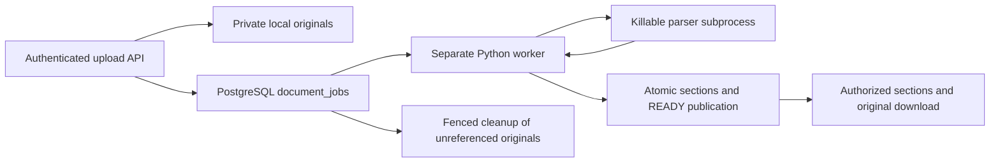

# Module 5 Stage 3 — document extraction and durable processing

Stage 3 adds a separate Python worker, structural validation, text extraction,
authorized section retrieval, durable physical cleanup, and conservative storage
reconciliation. No React upload controls, embeddings, RAG, or agents are included.
The existing development database is still at **0002**. All verification uses
new disposable databases and private storage directories.

## Architecture and schema

The API accepts and privately stores uploads as in Stage 2. It returns a queued
attachment and an extraction job. A separate worker claims jobs from PostgreSQL,
reads and verifies the original, runs a bounded parser subprocess, and publishes
the result. PostgreSQL provides the durable queue; no Redis or Celery is needed.



No migration or model change is needed. Revision **0003**, introduced in Stage 1,
already contains the required relationships and fields:

- `documents`: workspace-scoped metadata and its independent `registered` /
  `archived` lifecycle. Processing never changes the filename or lifecycle.
- `document_files`: immutable storage key, SHA-256, processing status, error /
  warning code, parser version, and processing timestamp; cascades with its document.
- `document_sections`: ordered text with optional page, heading, and line references;
  cascades with its document. No partial sections become available.
- `document_jobs`: extraction and `delete_files` jobs with attempts, availability,
  lease token/expiry, and terminal history. Its storage key survives document
  deletion, while the document foreign key becomes NULL.

Existing metadata-only records and all Module 1–4 endpoints remain supported.
They do not acquire attachments or extraction jobs automatically.

## Leases, transactions, and recovery

A **claim** is a short transaction selecting one eligible job with
`FOR UPDATE SKIP LOCKED`. Other workers skip locked jobs. The claim increments
attempts and installs a fresh UUID lease token. Parsing does not hold a database
transaction open. A separate heartbeat renews only a live, matching token.

A **fencing token** proves which claim may publish. Beginning, completing, failing,
and renewing compare the job identity, token, attempt number, input key, state,
and database clock. An expired worker cannot renew or overwrite newer work.
Document operations lock workspace → document → attachment → job, matching API
finalization/deletion. They explicitly use READ COMMITTED isolation. Renewal first
locks the matching job, then checks database time. This prevents a heartbeat from
reviving a lease that expired while waiting for an unchanged row-lock holder.

Successful publication replaces sections, marks the attachment `ready`, and marks
the job `succeeded` in one transaction. A final conditional write checks lease
expiry after inserts; failure rolls back all those writes. Reprocessing is
idempotent. Deletion or replacement during parsing cancels obsolete work rather
than recreating the document or publishing old sections.

Attachment states are `queued` → `processing` → `ready` or `failed`. Transient
storage, database, worker interruption, or containment-availability failures
return work to `queued` while attempts remain. The default maximum is three
attempts from the existing job schema. Backoff is `2 × 2^(attempt−1)` seconds,
capped at 60 seconds. Malformed, encrypted, unsafe, integrity-invalid, over-limit,
or timed-out input fails without repeated parsing. Exhausted stale jobs become
terminal failures. There is no new user-facing retry endpoint in this stage.

If PostgreSQL is unavailable while recording an outcome, the worker logs a
sanitized warning. The durable lease remains recoverable after expiry. A crash
after claiming also leaves durable work for a replacement worker. `Ctrl+C` (or
handled SIGTERM on supporting platforms) requests shutdown, cancels an active
parser, and requeues its job when the database and lease permit. Forced termination
relies on stale-lease recovery.

## Extraction and source references

| Format | Parser and checks | Source references |
| --- | --- | --- |
| PDF | `pypdf`, strict parsing, encryption rejection, bounded object/stream traversal, active-content/embedded-file rejection | Actual 1-based page number, including gaps for blank pages |
| DOCX | ZIP and XML preflight, then `python-docx`; reject unsafe archive paths, encryption, macros, embedded objects, DTD/entities, and external relationships | Body-order paragraphs and table rows; `heading` includes paragraph/table/row identity and available heading text |
| TXT | Strict UTF-8 and control-character checks | Actual inclusive 1-based line ranges |
| Markdown | Strict UTF-8 plus `markdown-it-py` tokenization with HTML rendering disabled | Actual token line ranges and available headings |

DOCX pagination is not invented: Word layout depends on a rendering engine.
Sections retain body paragraph and table-row order; nested content in a table
cell remains in its containing row. Text line endings are normalized. These
sections preserve source locations rather than implementing retrieval chunks.
Markdown links/images are treated as text; no remote resources are fetched.

Valid documents without extractable text, including scanned PDFs, finish `ready`
with `warning_code: "no_extractable_text"` and an empty section list. There is no
OCR. Structural validation is **not malware scanning** and cannot guarantee that
a downloadable original is harmless. The conservative policy can reject otherwise
legitimate PDFs with actions/links and DOCX files with external relationships.

The original is read through `PrivateStorage`, capped at its measured size, and
SHA-256 checked before parsing. Parent code validates the child's JSON and result
limits before database publication. Raw parser errors, document text, private
paths, database URLs, and credentials are not used as public error messages.

## Resource containment and configuration

Parsing runs in a separate process. The parent caps input/output pipes, discards
stderr, enforces the wall-clock deadline, and kills/reaps the child on timeout,
cancellation, or excessive output. The child receives bytes, canonical content
type, limits, and parent PID; it does not receive a database URL or storage key.
It clears its minimal environment and does not load `Settings` or `.env`.

On Windows, a Job Object enforces memory, kill-on-close, and a single process.
The child waits for input until the parent installs containment; failure closes
the process without parsing. The launcher uses the real Python interpreter and
trusted installed package directory because the Windows virtual-environment
redirector can spawn an extra process. Python isolated mode and `-B` disable user
Python paths and bytecode writes. POSIX code sets address-space, CPU, file-size,
descriptor, and core-dump limits; Linux also requests parent-death termination.

This is resource containment, **not an OS security sandbox**: no separate user,
network namespace, filesystem isolation, or antivirus is supplied. Run the
worker as a minimally privileged account, keep parser dependencies patched,
and review stronger deployment isolation before accepting hostile public traffic.
Windows behavior was exercised here; POSIX/Linux behavior requires verification
on the deployment platform. Hard native allocations may terminate a child with
`parser_failed` rather than a more specific memory code.

Non-secret defaults are documented in `backend/.env.example`:

| Environment variable | Default |
| --- | --- |
| `EXTRACTION_TIMEOUT_SECONDS` | 60; may be reduced, never increased above 60 |
| `EXTRACTION_MEMORY_MB` | 512; range 128–2048 |
| `EXTRACTION_MAX_PDF_PAGES` | 500 maximum |
| `EXTRACTION_MAX_TEXT_BYTES` | 2,000,000 UTF-8 bytes maximum |
| `EXTRACTION_MAX_SECTIONS` | 5,000 maximum |
| `EXTRACTION_OUTPUT_BYTES` | 20,000,000; bounded JSON transport including Unicode references |
| `DOCX_MAX_ENTRIES` | 1,024 |
| `DOCX_MAX_EXPANDED_BYTES` | 40,000,000 total |
| `DOCX_MAX_ENTRY_BYTES` | 20,000,000 per entry |
| `DOCX_MAX_EXPANSION_RATIO` | 100 |
| `WORKER_LEASE_SECONDS` | 120; must exceed timeout by at least 15 seconds |
| `WORKER_RETRY_BASE_SECONDS` | 2 |
| `WORKER_POLL_SECONDS` | 1 |
| `RECONCILIATION_MIN_AGE_SECONDS` | 86,400; minimum allowed is 3,600 |
| `RECONCILIATION_MAX_ENTRIES` | 10,000 |

Additional PDF object/depth/decompressed-stream and DOCX XML structure budgets
provide fixed defensive ceilings. Settings reject inconsistent output, lease,
and ZIP limits. The JSON output budget must cover twice the maximum text bytes
(JSON escaping), plus 2,560 bytes per section for Unicode headings and source
metadata, plus 1,024 bytes for the envelope. Worker startup preflight uses the
reconciliation entry budget too;
exceeding it stops before existing permissions or objects are changed. Actual
upload size remains inclusively capped at 10,000,000 bytes.
`MAX_UPLOAD_BYTES` may lower that cap, but configuration above it now fails at
startup. This prevents intake from accepting a legacy oversized override that the
worker's fixed input ceiling would reject later.
Storage must be an absolute private local root shared by API and worker; it must
never be served as static content. No paid service or per-document API fee is added;
costs are local CPU, memory, database, and disk use.

## Authorized API contracts

Stage 2 upload, metadata, deletion, and download contracts remain unchanged.
Downloads now become available naturally after successful worker processing.

```http
GET /api/v1/workspaces/{workspace_id}/documents/{document_id}/sections?limit=50&offset=0
```

Response example (identifiers abbreviated here only):

```json
{
  "document_id": "<document UUID>",
  "items": [{
    "id": "<section UUID>", "ordinal": 0, "text": "First source line.",
    "page_number": null, "heading": null, "line_start": 1, "line_end": 1
  }],
  "limit": 50, "offset": 0, "has_more": false
}
```

Limit is 1–100 and offset is nonnegative. Ordering is by ordinal. Owners, editors,
and viewers can read within their workspace. Missing/expired sessions return 401;
inaccessible workspace/document returns 404; a metadata-only document has no file
and returns 404; queued/processing/failed content returns 409; invalid pagination
returns 422. Schema-not-ready returns 503. Read requests do not need CSRF tokens;
existing cookie, CSRF, origin, role, and upload-idempotency protections remain.

Inspect `/file` for status, stable error code, warning, and download availability.
Use `/sections` for extracted text and `/download` for the authorized original.
Neither API exposes private storage paths or a partially published extraction.

## Durable cleanup and conservative reconciliation

Deleting a document hides metadata, sections, and downloads immediately and leaves
a durable `delete_files` job retaining the key. The worker locks the workspace and
job, rechecks attachment references with a fresh database snapshot, and deletes
only an unreferenced original. Missing files are an idempotent success. A failure
or uncertain commit can safely retry. Referenced keys are retained; cleanup jobs
eventually fail after their bounded retries instead of deleting live originals.

Reconciliation is an explicit maintenance command, not an automatic startup sweep:

- A cross-process shared/exclusive storage activity lock protects active uploads
  from maintenance until receive, finalization, compensation, and cancellation
  joins are finished. Cleanup also participates. A busy pass defers safely.
- A sibling lock file stays outside the object inventory and is never removed or
  replaced by the application. All processes must share this same local root.
- Inventory is bounded, rejects links/reparse points/unexpected objects, and
  verifies file identity before acting. An incomplete inventory performs no cleanup.
- Objects younger than the configured grace period remain untouched. Old originals
  with a committed attachment or queued/running job remain untouched. Old orphans
  in an existing, locked workspace receive a durable cleanup job, never direct unlink.
- Stale `.part` files can be removed only under the exclusive fence, with a healthy
  0003 database, age check, and unchanged file identity. Uncertain database state
  aborts remaining work. Prior completed actions remain safe and idempotent.
- Unknown workspace keys are retained for operator investigation. Terminal jobs
  and deleted-upload idempotency tombstones are never purged. A deleted nonce
  continues returning 409 even after physical cleanup.

Database/file operations cannot share one atomic transaction. Disk failure, power
loss, hard termination, or missing workspace state can require maintenance/manual
investigation. Failed cleanup jobs remain visible in the database; reconciliation
can queue another attempt for an old unreferenced original. There is no admin UI,
automatic scheduler, multi-host storage coordination, or tombstone retention policy.
Use a trusted local filesystem and protect the root/parent from other writers.
Empty UUID namespace directories are retained; they count toward the scan budget
and may require operator tuning or separately reviewed maintenance at scale.
Storage startup preflight precedes activity locking. Concurrent initialization and
private writes/maintenance can encounter a disappearing temporary or transient
hardlink and fail closed. Retry startup or maintenance after activity settles;
this availability limitation does not permit speculative original deletion.

## Startup and shutdown

**Do not start this worker against the current development database at 0002.**
It fails closed before initializing storage and never applies migrations.
The exact backup/restore-drill and development upgrade procedure remains in
[Module 5 Stage 2](MODULE5_STAGE2.md#development-migration-and-backup-procedure--separate-approval-required).
That procedure needs separate approval; no development migration was performed.

After an approved backup and 0003 upgrade, API and worker must use the same
`DATABASE_URL` and absolute `PRIVATE_STORAGE_ROOT`. In separate PowerShell windows:

```powershell
Set-Location C:\Users\yvenk\Desktop\agentsphere-ai\AgentSphere-AI\backend
& .\.venv\Scripts\python.exe -m uvicorn agentsphere.main:create_app --factory --host 127.0.0.1 --port 8000 --no-proxy-headers
```

```powershell
Set-Location C:\Users\yvenk\Desktop\agentsphere-ai\AgentSphere-AI\backend
& .\.venv\Scripts\python.exe -m agentsphere.worker
```

Press `Ctrl+C` to request graceful worker shutdown. For operator-controlled runs:

```powershell
& .\.venv\Scripts\python.exe -m agentsphere.worker --once
& .\.venv\Scripts\python.exe -m agentsphere.worker --reconcile
```

`--once` attempts one available job; exit 0 does not promise that document became
ready. Inspect `/file` or the job record. `--reconcile` emits sanitized JSON counts;
exit 1 means maintenance deferred or encountered uncertainty. It only queues
original cleanup: run the worker afterward to execute those jobs.

## Verification and file responsibilities

Run from `backend` with the existing Poetry environment:

```powershell
& .\.venv\Scripts\python.exe scripts/verify_stage2.py -q
& .\.venv\Scripts\python.exe scripts/verify_processing.py
& .\.venv\Scripts\python.exe -m ruff check src tests scripts
& .\.venv\Scripts\python.exe -m ruff format --check src tests scripts
& C:\Users\yvenk\Desktop\agentsphere-ai\.tools\poetry\Scripts\poetry.exe check --lock
& .\.venv\Scripts\python.exe -m alembic heads
```

The existing `verify_stage2.py` name is retained; it runs the **complete current
suite**, including Stage 3. It creates a new random local database, upgrades only
that database to 0003, runs Alembic consistency checks, then pytest in isolated
schemas/private directories. `verify_processing.py` independently creates another
new 0003 database, real HTTP server, private root, generated test identities, and
separate CLI workers. Both remove only their own disposable database in `finally`.
They require the existing ignored local cluster configuration. Forced termination
may leave a named disposable database for separately reviewed cleanup.

From `frontend`, run `npm run typecheck`, `npm run lint`, `npm test`,
`npm run build`, and `npm run test:e2e`. Browser tests create their own disposable
database and retain the Stage 4 authentication/workspace/document regression flows.
No running application uses mock responses and no frontend code was changed.

| File or group | Purpose |
| --- | --- |
| `backend/src/agentsphere/extraction.py` | Format validation, text extraction, source references, parser budgets |
| `parser_process.py`, `sandbox.py`, `process_limits.py` in the same directory | Child protocol, bounded process execution, OS resource limits |
| `worker_jobs.py`, `worker.py` | PostgreSQL claims/fences/publication and separate worker CLI |
| `reconciliation.py`, `storage.py` | Conservative inventory/cleanup and cross-process storage fencing |
| `api/document_files.py`, `schemas/documents.py` | Authorized section pagination and upload activity fence |
| `config.py`, `.env.example` | Validated resource/recovery configuration |
| `pyproject.toml`, `poetry.lock` | Pinned parser dependency resolution |
| `backend/tests/test_extraction.py`, `test_parser_subprocess.py`, `test_storage_activity.py`, `test_config.py` | Format adversaries, real child resource/termination tests, filesystem safety, settings bounds |
| `backend/tests/integration/test_processing_jobs.py`, `test_processing_api.py`, `test_storage_reconciliation.py` | Real PostgreSQL lease/race/recovery/API/maintenance tests |
| `backend/scripts/verify_processing.py` | Real HTTP plus independent CLI-worker lifecycle verification |
| `backend/src/agentsphere/main.py` | Accurate OpenAPI description; no automatic worker or migration |

| Verification | Result |
| --- | --- |
| Complete backend suite, fresh disposable 0003 database | 732 passed, 0 failed, 0 skipped; 314.49 seconds |
| Private storage and storage activity tests, included above | 94 passed |
| Extraction / real parser subprocess tests, included above | 86 / 38 passed |
| Job queue / processing API / reconciliation tests, included above | 22 / 18 / 23 passed |
| Frontend Vitest | 66 passed, 0 failed, 0 skipped |
| Chromium Playwright regression workflows | 17 passed, 0 failed, 0 skipped |
| Existing real HTTP auth/workspace/document checks | 53 passed, 0 failed |
| Real HTTP/PostgreSQL/separate-worker lifecycle checks | 79 passed, 0 failed |
| Ruff lint and formatting | Passed; 59 Python files |
| TypeScript, frontend lint, production build | Passed |
| Poetry lock validation | Passed |
| Alembic head and disposable schema consistency | 0003; no model/schema differences |
| Development database read-only comparison | 0002; all seven original table count/SHA-256 snapshots unchanged |
| Secrets and artifacts | No configured real credentials, private keys, database data, originals, environments, or generated artifacts in changed paths |

Real worker verification covers all four formats, queued-content blocking,
source references, verified original downloads, workspace roles, retrying a
processed upload nonce, malformed/encrypted PDF rejection, transient missing-file
recovery, process death after a durable claim, stale-lease takeover, durable
deletion/physical cleanup, deleted-nonce tombstones, active-upload maintenance
deferral, old orphan cleanup, and stale-temporary removal.

Unit/integration coverage also includes concurrent SKIP LOCKED claims, late and
expired fences, database rollback during publication, final-write lease expiry,
delete-during-parse races, reference-protected deletion, uncertain cleanup commits,
bounded retry exhaustion, changed filesystem identities, unsafe ZIP/XML/PDF input,
subprocess timeout/cancellation/output floods, environment isolation, and actual
Windows Job Object memory/child-process/kill-on-close enforcement.

Commit review added regressions for lease expiry while an unchanged lock holder
commits or rolls back; Unicode-heavy headings repeated across the maximum section
count; Type3 glyph names that resemble PDF action keys; valid tagged-PDF parent
links; and DOCX XML parts selected through case-insensitive content-type overrides.
The fixes retain unsafe-action/cycle rejection and require XML preflight even when
an archive entry's case differs from its override declaration. The output default
is now 20 MB so valid Unicode references fit within the bounded protocol.
The two lock-wait regressions failed before the renewal fix and passed afterward.
An indirect glyph-map regression also caught an initial xref-sweep compatibility
issue during the fix; its direct/indirect and shared-context cases now pass.
These review changes add 15 regression cases to the earlier 717-test suite.
The complete 732-test backend suite, frontend/browser/live API checks, and separate
worker verification were rerun successfully before staging. The focused parser /
configuration run passed 155 tests; the focused job-queue run passed 22.

Verification exposed and fixed Windows interpreter/package-path launch issues;
the base-interpreter regression now exercises that launch path. A synthetic worker
test initially omitted Windows USERPROFILE, which its Settings construction needs;
its fixture was corrected without adding that value to the parser environment.
The first full suite also exposed an outdated timeout-retry assertion; the test
now requires the intended terminal timeout policy. The final complete suite was
rerun successfully after these fixes and the upload-configuration ceiling
regression. No unresolved failures or skipped tests remain in this Windows run.

One existing Starlette/httpx TestClient deprecation remains. Playwright reports
Node's harmless NO_COLOR/FORCE_COLOR precedence notice. Windows LF/CRLF notices
are normal repository normalization warnings; `git diff --check` passes. These do
not suppress failed tests. Browser reports/caches/build output remain ignored.
Implementation and commit preparation use `develop` at unchanged HEAD
`583e41c0bde2eefee77db94499f4e8367485c9cd`: 24 changed files (9 modified, 15 new).
No commit, push, main-branch modification, or development migration was performed.

## Remaining limitations

No OCR, antivirus/CDR, password-protected extraction, user-triggered failed-job
retry, React upload/status UI, queue dashboard, periodic reconciliation scheduler,
quotas, container isolation, or distributed storage has been added. The worker is
synchronous and processes one job at a time; multiple processes can safely claim
separate jobs on this local shared storage. Windows hard resource limits have
tests; Linux/POSIX and production HTTPS still need platform/deployment validation.
Accessibility screen-reader assessment and non-Chromium browser assessment from
Module 4 also remain outstanding.

PDF text order/accuracy depends on the source and pypdf; there is no visual-layout
or OCR guarantee. Initial DOCX extraction covers body paragraphs and table rows;
headers, footers, comments, footnotes, text boxes, and tracked-change rendering are
not included. Keep the authorized original for source inspection.
