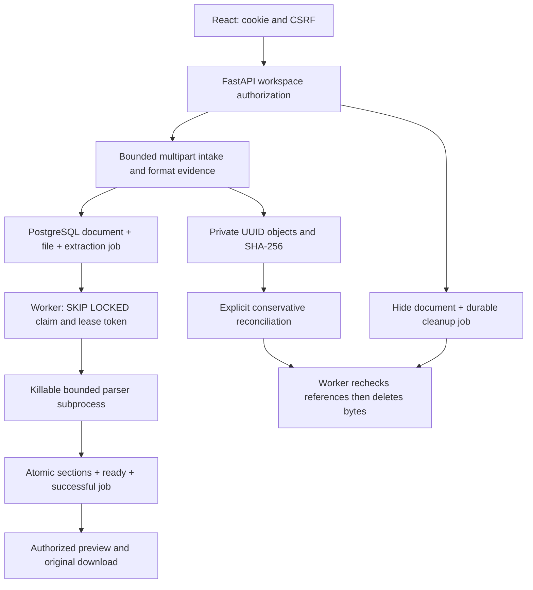

# Module 5 Stage 5 — final integration and technical handover

This guide describes Module 5's complete file lifecycle and Stage 5 review.
Historical Stage 1–4 guides record their own snapshots; this handover supersedes
their statements that later stages do not exist. No embeddings, vector database,
RAG, AI agents, or external AI calls are implemented.

Repository: `AgentSphere-AI`, branch `develop`.
Starting commit: `35e284568b41d9ebfb826bfe298d3c3cfe5c9f7c`.
Development remains **Alembic 0002**. No development migration or private-storage
initialization is authorized. Verification uses new disposable 0003 databases
and isolated private roots.

## Feature inventory and architecture

| Layer | Implemented behavior |
| --- | --- |
| Authentication | Argon2id, HttpOnly server-side sessions, expiry/revocation, CSRF rotation, database auth rate limits |
| Workspace security | Owner/editor write permissions; viewers read; backend authorizes every document/file/section operation |
| Metadata | Create, list, detail, edit/rename, archive/restore, delete, pagination and lifecycle filters |
| Upload | One PDF, DOCX, TXT, `.md` or `.markdown`; bounded multipart, generated keys, measured size, SHA-256, UUID idempotency |
| Private storage | Absolute local root, exclusive bounded writes, link/reparse/hardlink and integrity checks; no public static mount |
| Processing | PostgreSQL durable jobs, separate worker, bounded parser subprocess, retries, leases and fencing |
| Source references | Actual PDF pages; DOCX headings, paragraphs/tables; TXT/Markdown line ranges |
| Read access | Processing status, paginated plain-text sections, verified original download only after successful processing |
| Deletion | Immediate API invisibility, durable physical-cleanup job retaining the storage identifier |
| Maintenance | Conservative orphan/stale-temporary reconciliation, active-upload fencing, retained idempotency tombstones |
| Frontend | Progress, explicit retry/cancel, nonoverlapping polling, source preview, responsive permission-aware controls |



`documents.status` is the independent `registered`/`archived` lifecycle. Archiving
does not cancel processing or delete originals. `document_files.processing_status`
is `queued`, `processing`, `ready`, or `failed`. A metadata-only record acquires no
file/job automatically. File-backed measured size and canonical MIME cannot be
edited; rename and archive/restore remain supported.

Revision 0003 adds `document_files`, `document_sections`, and `document_jobs` with
foreign keys, uniqueness, indexes and check constraints. Document deletion
cascades attachment/section rows while job document references become NULL and
the storage key remains. Cleanup jobs also preserve deleted-upload tombstones.
The guarded downgrade refuses to discard populated new tables.

## Lifecycle and API contracts

Let `P = /api/v1/workspaces/{workspace_id}/documents` (no trailing slash).
Every operation needs authenticated workspace access; writes require the current
CSRF token and owner/editor role. Viewers can read. Inaccessible workspace/document
identifiers return 404 rather than reveal another workspace's content.

| Method and path | Contract |
| --- | --- |
| `POST P/uploads` | One multipart `file`, UUID `Idempotency-Key`; 202 with `document`, `file`, `replayed` |
| `GET P/{id}/file` | Processing state, safe error/warning codes, readiness flag; no private key/path |
| `GET P/{id}/sections?limit=50&offset=0` | Ordered sections, optional source locations, `has_more`; limit 1–100; success only |
| `GET P/{id}/download` | Checksum-verified original, attachment disposition, `no-store`, `nosniff`; success only |
| `POST P` | Existing metadata-only creation, 201; no original or extraction |
| `GET P`, `GET P/{id}` | Existing metadata list/detail; list limit 1–100, offset, lifecycle status |
| `PATCH P/{id}` | Existing metadata update; `status: archived` / `registered` archives/restores |
| `DELETE P/{id}` | 204 hides the record immediately; physical file cleanup is asynchronous |

Common failures: 401 expired/missing session, 403 CSRF or insufficient write role,
404 unavailable record/access, 409 conflicting/deleted intent or content not ready,
413 size bound, 415 unsupported media, 422 invalid metadata/content, 503 unavailable
schema/database/storage or upload capacity. Malformed multipart can return 400.
The UI uses safe fixed messages rather than raw parser/database exceptions.

1. Registration creates an account/workspace and leaves the user signed out.
   Login rotates session and in-memory CSRF token; reload restores `/auth/me`.
2. File selection creates an in-memory UUID intent. XHR reports transferred bytes;
   100% transferred does not mean extraction finished.
3. The API authenticates before reading the body, bounds the multipart envelope
   to the configured file limit plus 65,536 bytes, and bounds actual file bytes
   to **1–10,000,000 inclusive**. It validates filename, extension, canonical MIME
   and basic format evidence before acceptance.
4. Storage uses a generated UUID key, never a client path. Finalization rechecks
   session, CSRF, membership and role. A workspace lock serializes retries,
   deletion and final publication.
5. Document, attachment and extraction job commit together. Filesystem and DB
   cannot share one atomic transaction: compensation waits for uncertain commits
   and retains uncertain originals for conservative reconciliation.
6. The worker parses outside a database transaction, then publishes all sections
   and ready state atomically under the current lease. Partial/failed sections
   and unvalidated originals remain unavailable.
7. The UI avoids overlapping polls and ignores stale workspace/document/session
   responses. Polling stops on terminal state, deletion, logout, selection change
   or unmount. Preview is plain text, not document-provided HTML.
8. Deletion retains the key in a durable job. Cleanup rechecks live references;
   stale extraction cannot resurrect a deleted record.

Retrying the **same file with the same UUID** returns the committed document even
after a lost response. Different content conflicts. Deletion makes that key
conflict permanently, including after physical cleanup. The client never silently
retries. Closing/reloading the form loses the in-memory intent; inspect the
library before selecting a new intent after an uncertain response.

## Worker, extraction limits and recovery

Claims use short PostgreSQL `FOR UPDATE SKIP LOCKED` transactions. Each attempt
increments attempts and gets a new UUID lease token. Renew, failure and publication
check ownership, attempt, state and unexpired lease using DB time. Another worker
can reclaim expired work; the old process cannot publish over it. Sections are
replaced atomically with success, avoiding duplicate publication.

| Setting | Default / maximum |
| --- | --- |
| Actual upload | 10,000,000 bytes inclusive |
| Upload deadline / slots | 120 seconds / 2 per API process |
| Parser timeout | 60 seconds / 60 seconds |
| Parser memory | 512 MiB; configurable 128–2048 MiB |
| PDF pages | 500 |
| Extracted UTF-8 text / sections | 2,000,000 bytes / 5,000 |
| Parser JSON output | 20,000,000 bytes default; budget must fit bounded text/references |
| DOCX ZIP entries | 1,024 |
| DOCX expanded total / single entry | 40,000,000 / 20,000,000 bytes |
| DOCX expansion ratio | 100 |
| Job lease / poll | 120 seconds / 1 second |
| Attempts / transient retry | 3 attempts; exponential 2-second base, capped at 60 seconds |
| Reconciliation age / inventory | 86,400 seconds default (minimum 3,600); 10,000 entries default |

PDF uses pypdf; encrypted/unsafe/unsupported structures fail safely and actual page
numbers survive extraction. DOCX uses python-docx after bounded ZIP/XML checks,
preserving headings/paragraph/table information and rejecting dangerous content
and relationships. TXT uses strict UTF-8; Markdown uses markdown-it-py with actual
line ranges. Invalid UTF-8, disallowed controls, malformed packages and exhausted
limits are rejected. Conservative validation can reject legitimate active links
or unusual documents. Image-only PDFs have no OCR.

Parsers run in killable child processes with bounded input/output and no database
credentials in their reduced environment. Windows Job Objects bound memory/child
count and kill children on close. POSIX resource limits/parent-death behavior
exist in code but Linux execution was not verified here. This is **not malware
scanning, antivirus, content disarm/reconstruction, or a complete filesystem/network
security sandbox**. Originals can still harm an unsafe document reader.

Permanent validation errors mark `failed`; transient storage/database/process
failures retry within the attempt budget. Heartbeat failure fences publication.
A lost DB outcome relies on lease expiry rather than speculative state changes.
`--once` means one attempt (or no available work), not that every document is ready.
There is no public failed-job retry endpoint or administration console.

Cleanup checks references under workspace/job locks. Missing files are an
idempotent success; referenced files are retained. Uncertainty defers rather than
deletes. Reconciliation uses an exclusive storage-activity fence, complete bounded
safe inventory and healthy 0003 database. It acts only on old objects, queues
known-workspace orphan cleanup, and checks temporary-file age/identity. Unknown
workspaces, uncertain state and tombstones are preserved. Empty namespace
directories remain and count toward the scan budget.

## Threat and security review

| Threat | Controls / regression coverage |
| --- | --- |
| Expired session, forged write | HttpOnly rotation/revocation/expiry, CSRF + Host/Origin checks, auth rate limits |
| Cross-workspace access or stale role | Backend authorization on all file/section routes, final upload recheck, role/revocation tests |
| Traversal, device paths, link swaps | Validated filename, UUID internal paths, absolute private root, link/reparse/hardlink/identity checks |
| Body/ZIP/parser exhaustion | Actual-byte/envelope/deadline/slot limits, strict decode, ZIP limits, subprocess time/memory/output limits |
| Duplicate/uncertain upload | Scoped deterministic intent, serialization, content comparison, compensation barrier, tombstones |
| Stale worker or concurrent deletion | SKIP LOCKED, expiring fenced leases, atomic publication, reference-checked durable cleanup |
| Public internal details | Safe codes and API errors, plain text, authorized no-store original response |
| Uncertain DB/filesystem outcome | Retain uncertain originals; bounded retry and conservative reconciliation |

Stage 5 tightens new-input Windows device names with trailing stem spaces or
superscript COM/LPT digits, including `CONIN$`/`CONOUT$` device stems. UUID storage
was already safe; this was a filename
portability defect. Legacy reads, unchanged-name edits and exact original-intent
replays remain compatible; new reserved names/intents must fail. Regression tests
cover the boundary and a retry racing with deletion.

The review also reproduced a cold-initialization race: two application instances
sharing a new root could return 202/503 for identical concurrent requests. An
unfenced startup inventory could see a live `.part` disappear or observe the brief
two-link publication state, and correctly rejected that unstable snapshot.
Initialization now takes the existing exclusive OS activity fence with a bounded
two-second wait before inspecting or securing the managed tree. Uploads acquire
their shared fence using a bounded **asynchronous** wait, allowing other ASGI
work to progress. Only lock acquisition retries; request bodies/publication do
not replay. All unsafe-object, identity, ACL and overwrite checks remain strict.
Construction/settings/API startup still create nothing; explicit initialization
now provisions the permanent private sibling activity-lock file before preflight.
Managed-root permission changes still require successful preflight. Long active
operations can exhaust the wait and return a safe 503; maintenance activity itself
remains nonblocking. Deterministic publication/initialization and wait/cancel/error
regressions cover this fix.

Operational boundaries: no per-workspace storage quotas, per-user transfer quotas,
antivirus, global read/download concurrency bound, distributed file coordination,
or high-availability multi-host storage. Upload slots are per API process, not a
global deployment limit. Configure proxy/ASGI connection/body/time limits, rate
controls and disk monitoring. Already authorized download bytes cannot be revoked
retroactively mid-transfer. Successful parsing is not proof that originals are safe.
Metadata/workspace JSON fields are validated after body parsing; they do not have
the upload/auth-specific complete request-byte guards. Deployment must enforce
request limits on every route, not infer universal denial-of-service protection.

### Dependency advisory review (21 October 2026)

The initial Python audit of all **46** exact Poetry lock packages found
`PYSEC-2026-4320` / `GHSA-6q48-6c7w-9gw2` in `certifi 2026.7.22`. Compromised CA
intermediates make the old trust bundle unsafe for affected TLS clients. Certifi
is a development-group transitive dependency of HTTPX in this project; the file
parser does not make outbound API calls. Its local test use does not justify
retaining an affected TLS trust bundle. The maintainer describes the certificate
removal in its [security advisory](https://github.com/certifi/python-certifi/security/advisories/GHSA-6q48-6c7w-9gw2).
The [reviewed advisory](https://github.com/advisories/GHSA-6q48-6c7w-9gw2) identifies
`2026.10.19` as the corrected release, including the follow-up root-store update.

`poetry update certifi --lock` changed only that package version and its two
artifact hashes. Installing the existing lock updated only certifi. No direct
dependency, major framework version, application API or database schema changed.
Final pip-audit 2.10.1 checked all 46 locked versions, including platform-conditional
packages, with **0 known advisories and 0 skipped packages**. npm audit against the
public npm registry reported **0 known advisories** for the frontend lock. These
are dated database lookups, not proof that all dependency code is safe.

Reproduce the Python audit without changing project dependencies: create a
separate ignored tool environment, install `pip-audit`, export each Poetry
`[[package]]` name/version to a fully pinned requirements file, then run
`python -m pip_audit --disable-pip --no-deps -r <pinned-file> -f json` using that
tool interpreter. No application requirements are installed by the audit.
[pip-audit documentation](https://github.com/pypa/pip-audit) describes its advisory
service and options. The generated audit requirements do not repeat artifact
hashes: pip-audit emits a hash-hardening recommendation; Poetry's reviewed lock
retains both verified distribution hashes. No finding was ignored or suppressed.
The first audit-tool installation failed due to DNS on the configured index;
retrying explicitly against official PyPI succeeded. Tool environment and raw
reports remain ignored under `.local/module5-stage5`, outside the source inventory.

## Startup and complete user workflow

Verified setup uses Python 3.12, Poetry 2, Node 24/npm and PostgreSQL 18 on Windows.
Install dependencies with `poetry install --with lint` in `backend`, `npm ci` in `frontend` for
a new checkout; do not copy environments or credentials. Drivers require the
existing ignored local cluster configuration. On a genuinely new empty workstation
only, `local_postgres.py init` and `configure_local_auth.py` generate local setup
and refuse overwrites. **Do not run init on the existing environment.**

Safest complete file workflow now, from `frontend` with the cluster started:

```powershell
npm run test:e2e -- --headed --workers=1
```

This provisions a new 0003 database, isolated storage/fixtures, FastAPI 8002, Vite
5174 and real separate worker. Browser tests exercise registration/login,
workspaces, supported files, preview/download, archive/restore and deletion/cleanup.
Metadata/auth/role regressions run there too. Services/resources are removed
afterward: this is repeatable verification, not a persistent user environment.

The persistent **0002** app still runs metadata workflows:

```powershell
# Terminal 1, backend:
.\.venv\Scripts\python.exe scripts/local_postgres.py start
$env:APP_ORIGIN = 'http://127.0.0.1:5173'
.\.venv\Scripts\python.exe -m uvicorn agentsphere.main:create_app --factory --host 127.0.0.1 --port 8001 --no-proxy-headers
# Terminal 2, frontend:
$env:BACKEND_TARGET = 'http://127.0.0.1:8001'
npm run dev
```

Open [http://127.0.0.1:5173/](http://127.0.0.1:5173/). Use the same hostname for
browser/API/proxy; do not bypass Host/Origin/CSRF or add a CORS workaround. The
browser keeps HttpOnly cookies; CSRF and upload intent stay in memory, never
localStorage. Loopback HTTP requires explicit development settings. Production
uses one HTTPS origin and Secure `__Host-` cookies.

For a separately approved persistent **0003** environment, configure API and worker
with the same `DATABASE_URL`, absolute `PRIVATE_STORAGE_ROOT`, private permissions,
`.env.example` limits and locally generated `AUTH_RATE_LIMIT_KEY`. Then start the
API/frontend above and a third backend terminal:

```powershell
.\.venv\Scripts\python.exe -m agentsphere.worker
```

Register, sign in, select/create workspace, choose **Upload file**, submit a
supported file, wait for ready, preview source sections and download the original.
Rename/archive/restore use existing actions. Deleting hides immediately; the
worker removes bytes afterward. Owners/editors write; viewers read authorized
ready content. **Add record** still creates metadata without a file.

## Maintenance and recovery runbook

| Symptom | Safe action |
| --- | --- |
| Lost upload response | Retain file/form, use **Retry same upload** with its original intent; check library before a new key |
| Pending forever | Check worker and matching 0003 DB/root; start worker and inspect queue age/leases with authorized operator tools |
| Worker crash | Restart with the same settings, allow lease expiry; do not manually publish sections or reset attempts |
| Transient DB/disk failure | Restore availability/capacity/permissions, allow bounded retry/lease recovery; preserve uncertain objects |
| Failed validation | Read stable safe code and provide a corrected new document; no terminal-job reset API exists |
| Deleted record but bytes remain | Run queued cleanup; inspect failed jobs/references, never unlink solely because API record is gone |
| Old orphan/temporary objects | Approved 0003 root only: `python -m agentsphere.worker --reconcile`, then worker executes queued cleanup |
| Reconciliation incomplete/busy | Investigate unsafe inventory/budget, retry later; do not bypass fences |
| Forcibly killed tests | Verify exact run-owned DB/PIDs/root before separately reviewed cleanup; no wildcard deletion |

Ctrl+C requests orderly shutdown. A blocked OS/DB operation may delay exit; hard
termination relies on leases and later reconciliation. Deployment needs process
supervision, queue/failure/disk alerts, backups and restore drills. No automatic
maintenance scheduler, Prometheus/Grafana deployment or cloud rollout is included.
Keep generated account labels and local test reports private.

## Development backup and 0003 upgrade checklist — NOT EXECUTED

Development stays at 0002. This procedure requires **separate backup/migration
approval**. The guarded backup script and exact Alembic commands are in
[Stage 2's backup procedure](MODULE5_STAGE2.md#development-migration-and-backup-procedure--separate-approval-required).

1. Guard exact target host/port/database and commit, require intended local
   `agentsphere` and 0002, without printing credentials. Record read-only table
   counts and deterministic row hashes; check free space/client version/ACLs.
2. Stop API writers, workers and reconciliation; keep PostgreSQL running. No
   development original root currently exists. For future file-backed data,
   freeze writers and back up DB **and matching private objects** at one recovery
   point, protected with private permissions.
3. Run custom-format `pg_dump --no-password` to a new exclusive ignored
   `.local/backups` file. Pass credentials only in the short-lived child
   environment, never command arguments/docs. Record SHA-256 and verify
   `pg_restore --list`; failed/partial dumps are not backups.
4. Restore into a new explicitly named disposable DB with an appropriate test
   owner, verify 0002/counts/hashes and reads, and pair storage if present. Archive
   listing alone is **not** a restore drill. Never restore over development.
   Review grants/ownership before authorizing migration.
5. With separate approval and writers stopped, run `python -m alembic current`,
   `python -m alembic upgrade 0003`, `python -m alembic current`,
   `python -m alembic check` from backend using the guarded target profile.
   Require 0003/no differences and unchanged preexisting-record snapshots.
6. Configure approved private root and matching service settings, check permissions,
   restart and smoke auth/workspaces/old metadata plus synthetic upload through
   preview/download/deletion/physical cleanup.
7. On failure stop and investigate. Do not auto-downgrade, reset, restore over
   development or discard tables/objects. Recovery needs its own reviewed plan.

## Verification commands and evidence

```powershell
# backend: only new disposable databases/private roots receive migrations/jobs
.\.venv\Scripts\python.exe scripts/local_postgres.py start
.\.venv\Scripts\python.exe scripts/verify_stage2.py -q
.\.venv\Scripts\python.exe scripts/verify_processing.py
.\.venv\Scripts\python.exe -m pytest ../frontend/scripts/test_e2e_runner.py -q
.\.venv\Scripts\python.exe -m ruff check src tests scripts ../frontend/scripts/run_e2e.py ../frontend/scripts/test_e2e_runner.py
.\.venv\Scripts\python.exe -m ruff format --check src tests scripts ../frontend/scripts/run_e2e.py ../frontend/scripts/test_e2e_runner.py
poetry check --lock
.\.venv\Scripts\python.exe -m alembic heads
# frontend
npm test
npm run typecheck
npm run lint
npm run build
npm run test:e2e
npm audit --json --registry=https://registry.npmjs.org
```

Drivers run model/schema consistency checks against their new databases. Backend
tests include clean/populated migrations and guarded downgrade, security/roles,
actual-byte/multipart/idempotency/race cases, filesystem faults/link safety, parser
limits, crash recovery/fencing, deletion/reconciliation and 0002 metadata support.
Real browser tests use actual FastAPI and a separate worker; unit stubs are not
runtime mock data.

### Stage 5 verification record

These are freshly executed final Stage 5 results on 21 October 2026, after the
source fixes and certifi update; they are not inherited counts:

| Verification | Passed | Failed | Skipped / result |
| --- | ---: | ---: | --- |
| Complete backend pytest suite, disposable 0003 DB | **777** | **0** | **0**, 559.04 seconds; one existing TestClient warning |
| Complete frontend Vitest suite | **163** | **0** | **0**, 11 test files |
| Real Playwright Chromium/Chrome browser suite | **39** | **0** | **0**, 5.6 minutes; axe/keyboard/responsive included |
| Real FastAPI/PostgreSQL/separate worker | **79** | **0** | No omitted checks; all four formats and recovery/cleanup |
| Existing live API regression checks | **53** | **0** | Ran within the disposable E2E setup |
| Python browser-harness tests | **4** | **0** | **0** on Windows |
| Backend + reviewed Python harness Ruff lint | — | — | Passed |
| Ruff formatting | — | — | Passed, 64 Python files already formatted |
| TypeScript / frontend lint / production build | — | — | Passed |
| Poetry lock validation / Alembic head | — | — | Passed; 0003 is the code head |
| Clean/populated migration tests and disposable schema consistency | — | — | Passed; development was not upgraded |
| Python dependency advisory audit | 46 packages checked | 0 known advisories | 0 skipped packages after certifi fix |
| npm dependency advisory audit | 161 dependencies reported | 0 known advisories | No ignored advisories |

Before the storage fix, the
complete backend run reported **766 passed, 1 failed, 0 skipped** in 540.30 seconds.
Its sole failure was the concurrent cold-root initialization defect described
above. Earlier focused attempts reproduced the same safe 202/503 outcome. This
failure was investigated and fixed rather than marked flaky or skipped.

New reserved-name tests failed before hardening and pass afterward. A test using
an intentionally unfenced in-memory initialization implementation also fails at
the actual two-link publication boundary; the fenced implementation passes.
Additional tests cover cross-process contention, bounded wait, no body retries,
cancellation and not marking storage initialized after fence-exit failure.

No final test failures or skips remain. The broader Ruff check from the backend
working directory still reports the pre-existing unrelated **I001** import-order
issue at `frontend/scripts/verify_workspace_api.py:8`; that file is unchanged.
Scoped backend/changed harness lint and formatting pass. This is an outstanding
lint warning outside this change, not an all-repository clean-lint claim.
Pytest reports the existing Starlette/httpx TestClient deprecation. Node reports
`NO_COLOR`/`FORCE_COLOR` precedence, and Git may report LF/CRLF normalization.
The audit's unhashed-input recommendation and recovered DNS installation failure
are described above. No warning or failed attempt was silently suppressed.

### End-to-end and accessibility coverage

Browser verification uses real registration/login/logout/session restoration,
workspace creation/selection/URL restoration, owner/editor/viewer enforcement,
metadata CRUD/filter/pagination, expiration, CSRF and API-error recovery. Actual
TXT/Markdown/PDF/DOCX originals go through API, private storage, PostgreSQL and a
separate worker, then preview and byte-for-byte download. Tests exercise
archive/restore, immediate deletion visibility, eventual physical cleanup and
permanent deleted-upload idempotency conflicts. Lost/interrupted responses retry
the same UUID; a stopped worker leaves queued content gated until it resumes.

Malformed PDF and malformed DOCX reach failed processing with zero published
sections and no download. Invalid UTF-8 TXT/Markdown is rejected at intake with
no visible record. Empty, unsupported and 10,000,001-byte chooser inputs are
rejected without POST; bypassing the chooser still invokes backend validation.
Backend tests cover additional encrypted, unsafe, oversized, ZIP-expansion,
traversal, fault, cancellation, revocation, concurrent deletion and crash cases.

Axe WCAG A/AA checks cover login/registration, dashboard/document forms, uploads
and extracted previews. Keyboard checks cover skip links, mobile navigation,
form cancellation, details focus, refresh and section pagination without focus
loss. Responsive tests use widths **1440, 1024, 768, 390 and 320**; upload/preview
checks include **1440, 768 and 320**. No horizontal overflow is accepted.
Fresh synthetic-data screenshots of desktop/mobile dashboard and upload previews
were visually reviewed. They and all browser reports remain local and ignored.

| Platform/browser | Coverage |
| --- | --- |
| Windows, Python 3.12.2, PostgreSQL 18 | Backend, storage ACL/Job Object, real worker/API, disposable migrations |
| Node 24.16.0, npm 11.13.0 | Frontend install lock, tests, TypeScript/lint/build |
| Installed Chrome 155.0.8059.85 through Playwright Chromium project | Actual browser/axe/keyboard/responsive tests |
| Firefox/WebKit | Not verified: browser executables unavailable; no tests silently skipped |
| Linux/POSIX | Not executed: WSL and Docker unavailable; platform-specific code still needs CI |
| Manual assistive technology and production HTTPS | Not assessed; automated axe is not a substitute |

### Changed-file inventory

| File | Purpose |
| --- | --- |
| `backend/README.md` | Accurate Module 5 startup, safe 0002/0003 separation and worker/check instructions |
| `backend/poetry.lock` | Certifi trust-store advisory fix only; reviewed version and artifact hashes |
| `backend/src/agentsphere/schemas/documents.py` | Strict new filename policy with compatible stored-record fields |
| `backend/src/agentsphere/api/document_records.py` | Grandfather exact unchanged legacy filename on authorized updates |
| `backend/src/agentsphere/api/document_files.py` | Trusted exact replay allowance, strict new-record recheck, async activity acquisition |
| `backend/src/agentsphere/uploads.py` | Intake permits legacy names only for a server-authorized persisted replay |
| `backend/src/agentsphere/document_lifecycle.py` | Correct stale worker description |
| `backend/src/agentsphere/storage.py` | Exclusive fenced initialization and bounded contention handling |
| `backend/tests/test_documents.py` | New reserved-name rejection and nearby valid-name regressions |
| `backend/tests/test_uploads.py` | Multipart reserved-name regressions |
| `backend/tests/integration/test_stage5_api_security.py` (new) | New-intent rejection, legacy CRUD/replay compatibility, in-flight retry/deletion |
| `backend/tests/integration/test_document_uploads.py` | Diagnostic response body on concurrent-upload assertion failure |
| `backend/tests/test_storage_activity.py` | Explicit-init permanent sibling fence and preflight permission assertions |
| `backend/tests/test_storage_initialization.py` (new) | Actual hardlink publication race, contention, process, timeout and exit-failure tests |
| `backend/tests/test_upload_activity.py` (new) | Async yielding, bounded acquisition, safe cancellation and no body retry |
| `frontend/README.md` | Link current complete handover and security/recovery guidance |
| `frontend/src/features/documents/validation.ts` | Matching strict device names and exact legacy editing schema |
| `frontend/src/features/documents/validation.test.ts` | Matching aliases and ordinary non-device names |
| `frontend/src/features/documents/DocumentForm.tsx` | Use server-provided original filename when editing existing records |
| `frontend/src/features/documents/DocumentForm.test.tsx` (new) | Legacy edit/safe rename, rejected new device names, locked file measurements |
| `frontend/e2e/uploads.spec.ts` | Real malformed DOCX/UTF-8 and invalid chooser regressions |
| `frontend/scripts/run_e2e.py` | Generate malformed/invalid synthetic fixtures inside each disposable run |
| `docs/MODULE5_STAGE5.md` (new) | Complete architecture, threat review, results and operational handover |

No migrations, database models, public API paths or direct dependency declarations
change in Stage 5. No uploaded originals, private state, raw reports or screenshots
belong in this inventory.

### Final repository and development-data safety

Read-only final checks confirmed development remains **0002**, with identical
counts and SHA-256 row snapshots for all seven baseline tables. None of the three
0003 storage tables exists there. Its private storage root and sibling activity
lock remain absent; neither was initialized or cleaned. Both final disposable
verification drivers removed only their own databases/storage and test services.
No development backup, migration, reset, data cleanup or storage operation ran.

The changed-file inventory matches **23 files: 18 modified and 5 new**, all
unstaged. Credential/private-key and generated-artifact checks found no included
credentials, originals, DB data, environments, reports, screenshots or caches.
`git diff --check` passes. The index is empty. Branch remains `develop`, HEAD
`35e284568b41d9ebfb826bfe298d3c3cfe5c9f7c`; `main` remains unchanged at
`803ec0e20deca93174579f8413a0be49ffb4fcb8`. Nothing was staged, committed or pushed.

## Remaining limitations and coverage boundaries

- Windows, local PostgreSQL and Chromium/installed Chrome are available. Firefox
  and WebKit executables, Linux/WSL and Docker are unavailable. Manual screen-reader
  assessment and production HTTPS deployment remain unverified.
- Axe/keyboard/focus tests sample workflows/viewports; they are not full accessibility
  certification. DOCX visual pagination, headers/footers, footnotes and textboxes
  are outside supported extraction. No invented source locations are added.
- No OCR, malware scanning, production OS isolation, persistent upload intent,
  resumable/batch uploads, quotas, admin queue console or retry UI. Downloads
  buffer at most the upload limit per request.
- API/workers share one trusted local filesystem/database. No distributed locks,
  S3, Redis/Celery or multi-host durability. Successful parsing is not proof an
  original is harmless.
- Orphans/tombstones/empty directories can accumulate. Conservative maintenance
  intentionally preserves uncertainty and may need operator investigation.
- TestClient deprecation, existing unrelated Ruff import classification and other
  run warnings are reported with final results, not silently suppressed.
